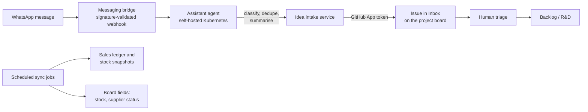

# Roadmap: multi-channel open-hardware store and product lifecycle

This roadmap grows `tindie-store-manager` from a Tindie listing helper into a
small, lean operating system for an open-hardware business. It covers ideas,
R&D, contract manufacture, multi-channel sales, inventory and decommissioning.

Work is tracked on the repository's kanban project board. Each product version,
manufacturing run and tooling upgrade is an issue that moves through the
lifecycle columns described below.

## Vision

Build a recognisable, trusted catalogue of open-hardware breakout boards and
kits in two focus areas:

1. **Energy monitoring:** metering-IC breakouts, FeatherWings, PMODs and
   reference designs (ADE, ATM90, V93xx, MCP39xx, CS54xx, STPM and successors),
   plus a modular DIN rail platform for open waveform capture, FPGA/ASIC
   metrology, and reproducible NILM research.
2. **LED lighting for cosplay props:** lantern rings, drum lights, addressable
   LED controllers, wearable power and mechanical prop housings.

The reference point is the presence Freetronics achieved in Australia under
Jonathan Oxer: a broad, well-documented, open catalogue that hobbyists,
educators and engineers recognised and trusted. Clones are expected and
acceptable. Openness seeds the ecosystem; the advantage is design velocity,
documentation, support quality and a reliable genuine source.

Hardware sales are not required to carry the whole business. Listed products
also serve as a public portfolio and lead generator for custom development and
contract engineering, which fill cash-flow gaps.

## Operating principles (lean)

- **Pull, not push:** build small batches (typically 10) only for proven
  demand, or as deliberate portfolio pieces with a capped budget.
- **Small at-hand inventory:** hold minimum viable stock locally. Use the
  Elecrow storefront as a consignment or partner buffer instead of shipping
  bulk stock to Australia.
- **One-piece flow per design:** limit work in progress. Each design moves
  through the board, and a new prototype starts only when a WIP slot frees up.
- **Evidence over assertion:** every manufacturing step keeps hashes, quotes,
  ERC/DRC results and bench-test records in the design repository.
- **Reuse before invention:** common passives, connectors, form factors
  (breadboard, FeatherWing, PMOD) and shared component libraries reduce BOM
  cost and quote churn.
- **Humans hold money and safety gates:** automation may prepare quotes,
  listings and drafts. Payment, mains-safety claims and public listing approval
  stay with a person.

## Product lifecycle

Every product version is a project-board item with a `Stage` field.

| Stage | Entry criteria | Exit criteria | Typical evidence |
| --- | --- | --- | --- |
| **Inbox** | Idea captured (WhatsApp, issue, customer request) | Triaged: interest area, product line, rough value | Idea issue |
| **Backlog** | Accepted idea | Selected for R&D within the WIP limit | Problem statement, target price, market check |
| **R&D** | Design repo created from template | Schematic, layout and simulation complete; ERC/DRC clean | KiCad project, datasheets, design notes |
| **Prototype** | Gerbers and BOM frozen for a prototype run | Bench tested; issues logged | Bare-PCB or small PCBA order, test log |
| **Quote** | Production package exported | Supplier quote reviewed and accepted, or revision requested | Elecrow PCBA quote (PN), BOM and placement hashes |
| **Revision** | Quote or bench issues require changes | Revised package re-quoted | Change log, new hashes |
| **Payment** | Quote accepted by a person | Payment confirmed | Supplier order number (not stored with personal data) |
| **Production** | Supplier production started | Shipped | Supplier progress percentage |
| **Receive and QA** | Boards delivered | Incoming inspection and functional test passed | Test results, photos, yield |
| **Listed** | Stock available | Published on Tindie, Elecrow or both | Product YAML, listing IDs, images |
| **Sustaining** | Selling | Demand, feedback or obsolescence triggers a decision | Sales, feedback, stock and lead-time metrics |
| **Next revision** | Sustaining decision to revise | New version enters R&D | Linked issue for version N+1 |
| **Decommission** | Low demand, obsolete parts or a superseding product | Listings retired, stock cleared, docs archived | Last-time-buy note, EOL notice |

A product version can loop between **Quote** and **Revision** several times.
Stage changes must record the evidence link in the issue.

### Interest areas

Each item is tagged with one or more interest areas, so the board shows a
balance of work across disciplines:

- **Electronics:** schematic, PCB layout, analog front ends, power, EMC and
  safety isolation.
- **Mechanical:** enclosures, prop housings, diffusers, 3D printing, laser or
  acrylic panels, STEP/fit checks.
- **Software and firmware:** drivers, ESPHome/Arduino/MicroPython libraries,
  FPGA/ASIC cores, store tooling and automation.

## Kanban project board design

Repository project: **Store and Product Lifecycle** (private; linked to this
repository). Create or update it with:

```bash
uv run scripts/setup_project_board.py
uv run scripts/setup_project_board.py --supplier-orders path/to/orders.json
```

The script is idempotent. Product items are seeded from `products/*.yaml`.
Phase epics are public issues labelled `epic`. Supplier orders are draft items
seeded from an uncommitted JSON file, so quote prices stay in the private
project.

| Field | Type | Values |
| --- | --- | --- |
| Status | Single select (board columns) | Inbox, Backlog, R&D, Prototype, Quote, Revision, Payment, Production, Receive and QA, Listed, Sustaining, Decommission, Done |
| Product line | Single select | Energy monitoring, LED cosplay props, Store tooling, Contract and custom |
| Interest area | Single select | Electronics, Mechanical, Software and firmware, Business and operations |
| Channel | Single select | Tindie, Elecrow, Both, None |
| Decision | Single select | Invest, Sustain, Revise, Consolidate, Retirement candidate, Retired |
| Approval state | Single select | Proposed, Approved |
| Evidence confidence | Single select | High, Medium, Low |
| Version | Text | e.g. `v0.4` |
| Analysis URL | Text | Normalized business-case or portfolio review |
| Supplier ref | Text | Quote/PN/SKU reference (no personal data) |
| Quantity | Number | Units in the batch |
| Unit cost USD | Number | Landed or quoted unit cost |
| Stock | Number | Units at hand |
| Lifetime units | Number | Aggregated sales units without customer data |
| Target date | Date | Next milestone date |
| Last sale | Date | Most recent aggregated channel sale |
| Review date | Date | Next lifecycle evidence review |

Work-in-progress limits (initial):

- R&D: 3
- Prototype: 2
- Quote plus Revision: 4
- Production: no limit (supplier capacity), but payment needs approval

Recommended board views:

1. **Lifecycle kanban:** grouped by Status.
2. **Manufacturing:** filtered to Quote, Revision, Payment and Production;
   table view with Supplier ref, Quantity and Unit cost.
3. **Catalogue health:** Listed and Sustaining items, sorted by Stock
   ascending.
4. **Roadmap:** timeline by Target date, grouped by Product line.

## Phased roadmap

### Phase 0: foundations (now)

Status: in progress.

- [x] Product-as-code YAML per listing, stock CLI and Tindie V2 sync.
- [x] Playwright listing automation for Tindie drafts.
- [x] Stock-gated Google Ads guards for Tindie and Elecrow.
- [x] Elecrow bare-PCB and PCBA quote workflow with hash-verified uploads
      (proven on Tph_Synth_Featherwing v0.4).
- [x] Create the kanban project board, labels and lifecycle fields
      (`scripts/setup_project_board.py`).
- [x] Seed board items for every product YAML and every open supplier quote.
- [ ] Add the board views (Lifecycle kanban, Manufacturing, Catalogue health,
      Roadmap) in the GitHub UI. The API cannot create project views.
- [ ] Add `lifecycle` metadata to product YAMLs (stage, version, channels,
      design repo, supersedes/superseded_by, EOL date).
- [x] Add normalized product decisions, evidence confidence, sales actuals,
      review dates and approval-gated retirement candidates.

### Phase 1: multi-channel catalogue and inventory

Goal: one source of truth for what exists, where it is, and where it is listed.

- Extend the product schema with channel blocks:
  - `channels.tindie`: product ID, URL, state.
  - `channels.elecrow`: storefront SKU/URL, partner stock, state.
- Split stock into `stock.local` (at hand) and `stock.elecrow` (partner or
  consignment), plus `reorder_point` and `batch_size`.
- Add `scripts/sync_elecrow.py`: read public Elecrow storefront availability
  and, with user-run browser automation, partner and quote status.
- Add a unified `check_stock.py --channels` report with reorder alerts based on
  `reorder_point`.
- Add a component and BOM inventory for spare parts at hand (reels, headers,
  connectors), linked to per-product BOMs, so small top-up batches can be
  kitted locally.

### Phase 2: orders and sales records

Goal: know what sold, where, for how much, and what customers said.

- Add an append-only sales ledger (`data/ledger/*.jsonl` or SQLite) of
  normalised order lines: date, channel, SKU, quantity, gross, fees,
  shipping, country (region only), and status.
  - Customer names, addresses and emails are never committed. Store only
    channel order IDs and aggregate fields; personal data stays with the
    channel or an encrypted private store.
- Tindie: import orders via the official V1 order API.
- Elecrow: import storefront sales and payout reports (manual export or
  user-run automation; Elecrow has no public order API).
- Monthly report: units, revenue, margin per SKU, sell-through rate, days of
  cover, and channel mix.
- Capture customer feedback (reviews, questions, returns) as linked issues
  labelled `feedback` against the product version.

### Phase 3: manufacturing pipeline automation

Goal: repeatable design-repo to supplier flow with human approval gates.

- Standard design-repo template: KiCad 10 project, ERC/DRC/parity checks,
  manufacturing exporter, BOM sourcing via Mouser/DigiKey lookup, STEP
  turntable render, `quote.json` evidence records.
- `scripts/supplier_status.py`: summarise Elecrow service orders by state
  (Pending quotation, Quoted, Pending payment, In production, Completed,
  Canceled) and update the matching board items.
- Quote review checklist: component substitutions, DNP list, unit cost against
  target margin, freight, lead time.
- Receive-and-QA checklist and yield tracking per batch.
- Stale-quote housekeeping: flag quotes older than 30 days for re-quote,
  ordering, or cancellation.

### Phase 4: idea intake and agent assistance on self-hosted Kubernetes

Goal: message an idea from a phone and have it land in the backlog, with
agents helping to research and draft. Design proposal only; nothing here is
deployed yet.



- **Messaging intake:** reuse the homelab's existing WhatsApp messaging
  bridge and assistant agent. A message prefixed with an intent (for example
  `idea:`, `order:`, `feedback:`) becomes a draft issue with interest area,
  product line and a short summary. Unprefixed messages stay conversational.
- **Least privilege:** a dedicated GitHub App or fine-grained token can only
  create issues and edit project items in this repository. It has no access to
  supplier accounts or payment.
- **Scheduled sync jobs:** Kubernetes CronJobs run Tindie stock/order sync,
  public Elecrow availability checks, and the low-stock report. Results
  update board fields and post a daily digest back over the messaging channel.
- **Secrets:** API keys are stored as encrypted secrets (SOPS-style) and
  mounted at runtime. No browser profiles or session cookies run unattended in
  the cluster. Supplier-account automation stays a user-present workstation
  task.
- **Exposure:** no inbound public ports. Webhooks arrive through an outbound
  tunnel with signature validation. Dashboards are behind an identity-aware
  access proxy.
- **Local models:** short classification and summarisation can stay on the
  local GPU model; tool-calling research and drafting may use an external
  model through the existing gateway.
- **Optional:** a self-hosted inventory application (for example InvenTree)
  if YAML-based stock outgrows the repository. Keep the YAMLs as the published
  catalogue either way.

### Phase 5: catalogue growth and ecosystem

Goal: a recognisable catalogue in both focus areas, with docs good enough for
clones to point back to the original.

- **Energy monitoring:** consolidate around a common breakout pin map and
  FeatherWing/PMOD variants. Publish calibration guides, ESPHome components
  and comparison tables across metering ICs. Retire superseded parts (for
  example legacy SMD/kit boards with obsolete MCUs).
- **Open NILM development platform:** recover the delivered Crowd Supply DIN
  rail stack behind
  [whatnick/DIN_Rail_EnergyMonitor#1](https://github.com/whatnick/DIN_Rail_EnergyMonitor/issues/1).
  Standardize safe vertical risers for metering ICs, simultaneous ADCs, FPGA
  processing, and the open CTVT metrology ASIC; keep raw waveforms, datasets,
  local processing, and interfaces reproducible.
- **LED cosplay props:** productise lantern rings and drum lights into a
  family: controller, rings, diffusers and printable housings. Add
  battery-safe power modules and an open firmware with presets. Pair
  electronics with mechanical files (STEP/STL) and assembly guides.
- **Starter kits and bundles** that combine boards, sensors and cables at a
  better margin than single boards.
- **Docs site:** per-product pages generated from the product YAMLs, with
  version history, test results, design-repo links and "genuine source"
  messaging.
- **Community:** show-and-tell, contributor credits, and accepting design
  contributions under the existing open-hardware licences.

### Phase 6: services and contract work

Goal: turn the catalogue into a lead-generation and portfolio engine.

- "Need a custom version?" call to action on every listing and docs page,
  linked to a contact or intake form that creates a `contract` issue.
- Case-study pages built from shipped designs: metering front ends, FPGA/ASIC
  DSP, LED prop builds and enclosure work.
- Fixed-scope offerings: custom breakout from a datasheet, calibration and
  test fixtures, small-batch manufacturing management.
- Track contract pipeline items on the same board (Product line =
  Contract and custom) so they compete fairly for WIP capacity.

## Metrics

Reviewed monthly:

- **Flow:** lead time from idea to listed, quote-to-payment time, WIP per
  stage, revisions per product.
- **Inventory:** days of cover per SKU, stock-outs, dead stock older than
  12 months, cash tied up in stock.
- **Sales:** units and revenue per channel and per SKU, sell-through per
  batch, gross margin after fees and freight.
- **Quality:** batch yield, returns, feedback issues per version.
- **Business mix:** hardware gross margin compared with contract revenue.

## Risks and mitigations

| Risk | Mitigation |
| --- | --- |
| Clones undercut pricing | Compete on docs, support, revisions and genuine-source trust; keep a fast revision cadence |
| Stale quotes and duplicated orders | Stale-quote housekeeping; one board item per supplier reference |
| Cash tied up in slow stock | Batch sizes based on sell-through; partner stock on Elecrow; decommission dead lines |
| Component obsolescence | Lifecycle checks in BOM sourcing; preferred common parts; last-time-buy flags |
| Automation acting on money or safety | Human approval gates for payment, public listing and mains-related claims |
| Personal data leakage | Ledger stores aggregates and channel order IDs only; secrets encrypted; no cookies in Git |
| Single-person bottleneck | WIP limits, templates, checklists and agent-prepared drafts |

## How to contribute to the roadmap

- Open an issue using the lifecycle labels and add it to the project board.
- Keep one issue per product version or supplier order reference.
- Link evidence (design repo commit, `quote.json`, test log) when changing
  stage.
